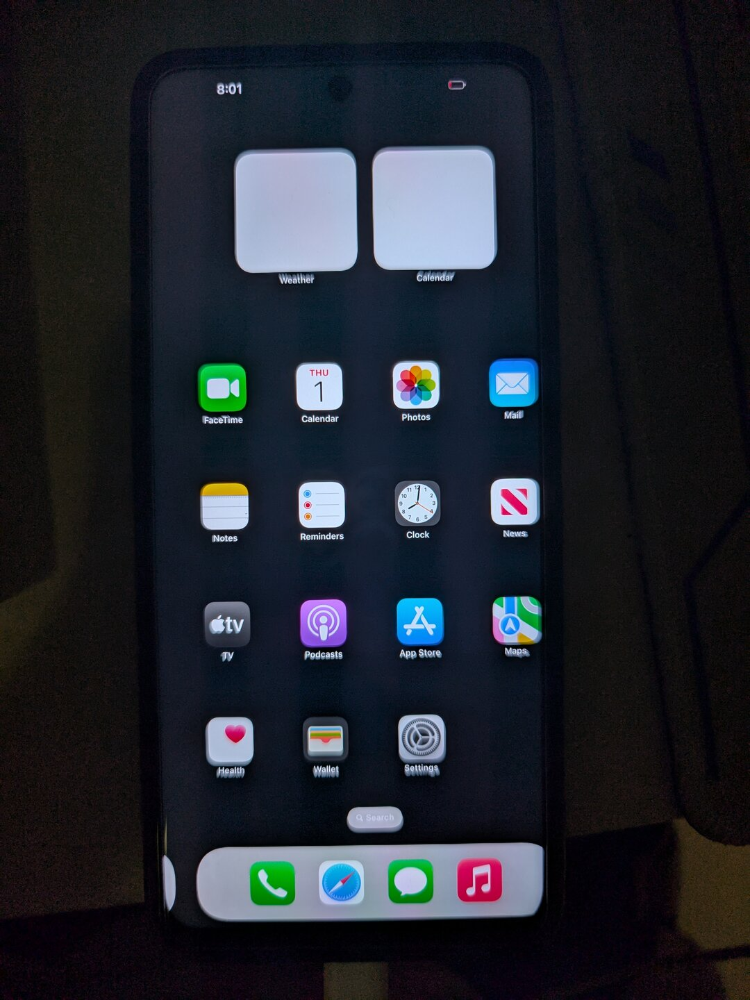

# HakiOS on MediaTek — Dimensity 8100 (MT6895)

把 Apple 开源的 XNU 内核和 iOS 16.5 的用户态跑在联发科天玑 8100 上。当前目标机是 **Redmi Note 11T Pro（`xaga`，MT6895）**，已经点亮桌面。



<details>
<summary>开机画面（同一台机，苹果 logo）</summary>


</details>

> 实验性的 bring-up 工作，不是可以日用的 ROM。没有 GPU 加速，触控、按键、USB、Wi-Fi 还在修，重启后不保存任何设置。

**只想装上试试**：[Releases](../../releases) 里有可以直接刷的 `hakios-xaga-boot_a.img`，五步流程见 [INSTALL.md](INSTALL.md)。要自己编译往下看。

---

## 目录

- [现在到哪一步了](#现在到哪一步了)
- [整体思路](#整体思路)
- [仓库结构](#仓库结构)
- [构建与刷入](#构建与刷入)
- [移植时遇到的一些困难](#移植时遇到的一些困难)
- [正在卡的地方](#正在卡的地方)
- [路线图](#路线图)
- [致谢](#致谢)
- [许可](#许可)

---

## 现在到哪一步了

| 部分 | 状态 | 说明 |
|---|---|---|
| 引导链 | ✅ | LK → `boot_a` 里的 mtkloader → XNU。不经 UEFI |
| 自编译 XNU | ✅ | `Darwin Kernel Version 22.5.0`，`4 of 4 processors are running` |
| UFS 读盘 | ✅ | HS-G4 双通道，2.32 GiB 的 `system.apfs` 读进内存 |
| 分屏与显示 | ✅ | 1080×2460 全屏可写，60 fps |
| iOS 用户态 | ✅ | SpringBoard 起来了，状态栏、小组件、Dock 全部渲染 |
| 触控（Novatek NT36672E） | 🚧 | 固件灌入、CRC 校验全过，事件缓冲仍恒读 `0x77` |
| 按键（keypad + MT6363） | 🚧 | 寄存器能读，判据没对上 |
| USB（MTU3） | 🚧 | 控制器配置已与 Android 工作态逐位对齐，PHY 侧 D+ 仍不上拉 |
| GPU（Mali-G610） | ⬜ | 走软件渲染，`CoreAnimation: Software renderer!` |
| Wi-Fi / 基带 / 音频 / 相机 | ⬜ | 未开始 |

画面整体右移一个固定偏移，已经排除 framebuffer 和 XNU 绘制层，指向 DSI / panel 时序。

---

## 整体思路

```
LK (bootloader, 未改动)
  └─ boot_a:  Android Image 头 + [mtkloader] + [XNU payload]
                │
                ├─ LK 把 mtkloader 放在 0x40000000 执行（不是 Image 头写的 0x40080000）
                ├─ mtkloader 通过 UFS 把 system.apfs 读进内存，建 boot_args 与设备树
                └─ 跳进 XNU
                     ├─ XNU 以 md0 = system.apfs 为根
                     └─ /sbin/launchd → stage0 → iOS 用户态
```

关键点：**MTK 路线完全不经 UEFI**。上游 Qualcomm 机型走的是 UEFI → loader → XNU，而 MTK 的 LK 直接从 `boot_a` 起，mtkloader 本身是裸机程序，跑在 LK 之后、XNU 之前。

`boot_a` 的布局（由 `mtk/tools/chainboot.py` 组装）：

| 偏移 | 内容 |
|---|---|
| `0x000000` | Android Image 头（header v4，1584 字节头 + 4096 字节签名） |
| `0x040000` | 原 Android `Image`（退路用，`chain_android()` 从这里起） |
| 之后 | mtkloader 程序本身 |
| 末尾 | XNU payload（"XNUP" 魔数，装内核 + ramdisk） |

`chainboot.py` 原本 `assert hver == 2`，xaga 是 v4，已改成支持 v2/v3/v4。

---

## 仓库结构

上游的 `hakios-xnu-kernel` 已经在那了，这个仓库只装我们在它之上写出来的部分。

```
tree/            直接落到上游 hakios-xnu-kernel mtk 分支上的新文件
  mtk/loader/ufs.h                            UFS 主机驱动（裸机，MMU 关闭）
  mtk/mt6895/loader/board.h                   xaga 的全部板级常量
  mtk/mt6895/drivers/input/hakios.nvt.c       Novatek NT36672E 触控
  mtk/mt6895/drivers/input/hakios.mt6895_keys.c  keypad + MT6363 按键
  mtk/mt6895/drivers/usb/hakios.mt6895_usb.c  MTU3 设备模式 gadget
  mtk/mt6895/configs/mt6895.config            SoC 层配置
  mtk/tools/xaga-*.sh                         xaga 专用的刷机 / 刻分区 / 取日志
  mtk/tools/mknvtfw.py                        厂商触控固件转 C 头
  mtk/tools/mkfont8x16.py                     点阵字体生成（替代 swift 版）
patches/
  0001-upstream-changes.patch                 对上游已有文件的修改
docs/
  BOARD.md                                    板级常量的出处
  UFS.md                                      UFS 主机驱动的完整过程
  DEBUGGING.md                                没有串口时怎么取日志
screenshots/     真机照片
```

`tree/` 里的文件按原路径拷进上游工作树即可，`patches/0001-upstream-changes.patch` 用 `git apply` 打，两边合起来才是一份能编译的状态。patch 覆盖 24 个文件、5123 行。

`drivers/input/hakios.nvt_fw.h` 是厂商触控固件转出来的 C 头（847 KB），不放进仓库，用 `mtk/tools/mknvtfw.py` 从厂商的 bin 现场生成。


---

## 构建与刷入

### 前置

上游 `hakios-xnu-kernel` 的 `mtk` 分支，加上本仓库的 `tree/` 与 `patches/`。需要 Linux x86-64、`clang`/`lld`、`ld64`（真正的 cctools，不是 `ld64.lld`）、`gawk`、Python 3、Theos 的 iPhoneOS16.5 SDK。

### 打补丁

```bash
cd hakios-mtk                      # 上游 mtk 分支工作树
git apply /path/to/patches/0001-upstream-changes.patch
cp -r /path/to/tree/mtk .          # 新文件
```

### 编译

```bash
cd hakios-mtk && source xnu-env.sh

./xnu/sync-drivers.sh
cp -p xnu/files/bsd/sys/hakios.input.h xnu-src/xnu-8796.121.2/bsd/sys/hakios.input.h

LC_ALL=C make kernel DEVICE=xaga   # 成功判据：make-kernel: built: hakios-kernel
make payload DEVICE=xaga

DEVICE=xaga ./mtk/loader/build.sh \
  -DBOARD_NO_UART -DBOARD_NO_OVL -DBOARD_SKIP_MENU -DBOARD_NO_CONNSYS \
  -DXNU_CORES=4 -DXNU_VERBOSE=0 -DXNU_DISPLAY=1 \
  -DXNU_WATCH_SECONDS=0 -DXNU_RETURN_AFTER='"70"'

python3 mtk/loader/build_flashed.py     # → xnu-flashed-slot_a.img（约 22.9 MB）
```

`LC_ALL=C` 不能省：`make-kernel.sh` 排不掉中文 locale 下的报错行。
`make kernel` 以 `exit status 2` 收尾是正常的，那是 kext symbol-set 检查在本配置下必然失败。

上面这行 `-DXNU_RETURN_AFTER='"70"'` 是开发用的：XNU 跑 70 秒后把控制权交回来，loader 接着 `chain_android()` 回 Android，于是刷一次就能自动取日志、自动回到能干活的状态，不用每次手动救。

给用户刷的版本把这一项改成 `'"0"'`（`xnu/files/osfmk/arm64/loader_return.c:464` 里 `seconds == 0` 就直接 return，永不移交），再关掉两个屏幕报告：

```bash
DEVICE=xaga ./mtk/loader/build.sh \
  -DBOARD_NO_UART -DBOARD_NO_OVL -DBOARD_SKIP_MENU -DBOARD_NO_CONNSYS \
  -DXNU_CORES=4 -DXNU_VERBOSE=0 -DXNU_DISPLAY=1 \
  -DXNU_WATCH_SECONDS=0 -DXNU_RETURN_AFTER='"0"' \
  -DBOARD_REPORT_PAGES=0 -DBOARD_REPORT_SYSTEM_IMAGE=0
```

Release 里那个 22.9 MB 的镜像就是这条命令的产物。别把开发版发给别人，它会在 70 秒后自己重启回 Android，看着像崩溃。

### 刷入

```bash
export S=GAJZ4HIN99AQ69Y9     # 换成自己的
adb -s $S reboot bootloader
fastboot -s $S flash boot_a xnu-flashed-slot_a.img
fastboot -s $S reboot
```

约 110 秒后自动回 Android（`BOARD_RETURN_TO_ANDROID 1`，开发版才有这个行为），然后取日志：

```bash
sh mtk/tools/xaga-pull-log.sh $S      # → xaga-logbook.bin
```

Release 那个版本不会自己回来，刷完就停在 iOS。要回 Android 就 `fastboot flash boot_a backup/boot_a_magisk.img`。

### 救砖

```bash
fastboot -s $S flash boot_a backup/boot_a_magisk.img
fastboot -s $S reboot
```

**先备份**，`mtk/tools/xaga-cycle.sh` 会检查备份存在才肯刷。本机的备份是 KernelSU 版 `boot_a`，md5 `a63b2e35a7c2522cb24a6a10332b9bc8`；换成官方 stock 会丢 root，而读 pstore 需要 root。

### 分区

`system.apfs`（2.32 GiB）装不进 64 MiB 的 `boot_a`，需要从 `userdata` 尾部刻一块 `xnusys` 出来：

```bash
HAKIOS_SERIAL=$S mtk/tools/xaga-carve.sh --gib 2.5   # 只算不写，先看方案
HAKIOS_SERIAL=$S mtk/tools/xaga-carve.sh --gib 2.5 --write
```

`xaga` 的 GPT 用 **4096 字节逻辑块**（header 在 byte 4096，不是 512），这是刻分区前必须知道的。刻完要 `fastboot erase userdata` 让 Android 按新尺寸重建 f2fs，否则 surfaceflinger 会 SIGBUS。

---

## 移植时遇到的一些困难

下面这些每一条都是拿真机轮次换来的。写在这里，后来的人可以少走一遍。

三块内容单独写在 `docs/` 里，篇幅太长不适合塞进 README：

- [UFS](docs/UFS.md) —— 从读不出一个字节到 HS-G4 双通道，2.32 GiB 读进内存
- [板级常量出处](docs/BOARD.md) —— `board.h` 里每个数字从哪来
- [没有串口怎么取日志](docs/DEBUGGING.md) —— logbook、看门狗快照、像素色带

### UFS

| 症状 | 根因 |
|---|---|
| `HCS` 恒 `0x0`，写 `HCE` 读不回 1 | 电源域和参考时钟由 TFA 通过 SMC 授予，纯写寄存器无效。`MTK_SIP_UFS_CONTROL = 0xC2000276` |
| `IS` 写宽掩码后门铃彻底死 | `IS` 是写 1 清零，写 `0xffffffff` 会把整个中断状态机打死。只能写单 bit |
| 清 `HCE` 后寄存器块永久读 0 | 绝对不能清 `HCE`。SPM 会把无时钟域断电，之后整块读 0（`IE` 仍可写 ⇒ 不是总线问题） |
| `PWR_FATAL_ERROR`、三个 READY 位全灭 | `UTRLCLR` 只能在列表停止时写（JESD223）。顺序反了控制器就判死，`UTRLRSR` 再也置不上 |
| `OCS_PEER_COMM_FAILURE` | 设备 RST_n 被脉冲后对端 UniPro 栈归零，必须 `DME_RESET → DME_ENABLE → LINK_STARTUP` |
| SCSI 命令全返回 `response 0x1` | 缺 `fDeviceInit` 握手：`SET_FLAG(FDeviceInit)` 再轮询 `READ_FLAG` 清零 |
| 读盘 43 分钟 | 链路停在 PWM-G1。跑 `DME_SET(PA_PWRMODE)`，判据是 `HCS` bits 10:8 = `PWR_LOCAL`。通了之后 HS-G4 双通道，2600× |
| 8 MiB 请求超时 | 轮询预算 `UFS_MAX_POLLS` 没按数据量缩放。8 MiB 一次约需 880 万次轮询 |

还有一个：`mtkloader` 全程 MMU 关闭，所有内存当 device memory —— 只能 32 位对齐访问、无 SIMD、非对齐宽访问会 fault 而不是读出错值。

### 引导链

LK **忽略 Image 头的 `text_offset`**，把程序固定放在 `0x40000000`。链接脚本写 `0x40080000` 的话，所有 `adrp` 绝对寻址整体偏 512 KiB，`parse_payload()` 读到的魔数是垃圾，然后静默进 `chain_android()` 开机循环。表现是"刷完就循环重启"，看着像硬砖。

修法：`link.ld` 改 `. = 0x40000000`，`start.S` 的 `text_offset` 改 0，栈挪到 `+0x30000`，`payload_find()` 用 `adr x0, _start` 拿真实地址。

`chain_android()` 也有坑：它把 `boot_a+0x40000` 的 Android Image 拷到 `0x40080000`，源在 `0x40040000`，目标比源高 —— 正向逐 8 字节拷贝会自我覆盖。改成双向拷贝加尾部逐字节。

### iOS 用户态

**Data Migration 死锁**是最费时间的一个。症状：`36 checks 0 failed`、`Early boot complete`、SpringBoard 和 backboardd 全部 spawn，但屏幕停在 BootUI overlay 不撤，`Main will unblank` 一次都不出现。

根因：`datamigrator` 靠 `/private/var/mobile/Library/Preferences/com.apple.migration.plist` 判断要不要迁移。文件在源码树里存在，但 `userland/build.sh` 把它写进 `var.skel` 的那段代码在一个 `if [ -d $DARWIN/rootfs/usr/lib ]` 块里 —— 本机那个目录不存在，整块被跳过 —— 所以 `/private/var` 每次启动都是空的，反复迁移。

同类问题在 `build.sh` 里有好几处，`cp obj/init root/sbin/launchd`、dyld 缓存别名、`libhakios*.dylib` 都曾被这同一个 `if` 吞掉。这些现在都挪到 `fi` 之后无条件执行了。

**dyld 共享缓存**是另一个：iOS 的 `/usr/lib/libSystem.B.dylib` 只存在于 shared cache 里。缓存实体在 `system.apfs` 的 `/System/Cryptexes/OS/System/Library/Caches/com.apple.dyld/`，但 dyld 首选 `/System/Library/Caches/com.apple.dyld/`，那个目录不存在。用 APFS 合成目录的 `PATH=TARGET` 别名解决：

```c
check(synthetic_dir("/System/Library/Caches=/System/Cryptexes/OS/System/Library/Caches"),
      "the dyld shared cache reachable as /System/Library/Caches");
```

**launchd 权限**：本机 `umask 0002` 会让 `root/` 树变成 0775/0664，launchd 要求 plist 只能 root 写，直接报 error 122。`mkapfs.py` 的 mode 直接取自主机文件，所以打镜像前必须 `chmod` 一遍。

### 触控

Novatek 的协议里有几个不对称的地方，反汇编真机的 `nvt36672c.ko` 才看清：

- 所有多字节**写**的第一个字节必须置 bit7（`SPI_WRITE_MASK`）。漏了的话芯片把每块当**读**，139264 字节固件一个都没进去，而 CRC 还会"通过"（因为读回来的是事件缓冲的填充值 `0x77`）
- `nvt_read()` 不设 page（厂商依赖 probe 时锁存），所以每个 CRC 读之前必须显式 `nvt_set_page()`
- INT 是**高有效**，主循环条件写反了就一直不读
- 指纹偏移是 `FINGER_BYTES * i`，不是 `1 + 6*i`

`delay()` 的单位也要注意：XNU 的 `delay(int usec)` 收的是**微秒**。我一开始按毫秒写，32 轮 × 250 实际只跑了 8 毫秒，白等了一轮。

---

## 正在卡的地方

### USB：PHY 的 D+ 拉不起来

控制器这边的寄存器已经和 Android 工作态逐位对齐了（`MISC_CTRL 0x80000003`、`LTSSM_CTRL 0x223`、`U3_CTRL_0P 0x88`、`DEVICE_CONTROL 0x99`、`POWER_MANAGEMENT 0x64e1`），`SOFT_CONN` 也置上了，但：

- `USB20_OPSTATE` 恒 0
- 六个 cable 中断（`CONN`/`DISCONN`/`SOF`/`RESET`/`RESUME`/`SUSPEND`）全部使能，整整几秒零触发
- 主机侧 `dmesg` 在整个 iOS 窗口里零 USB 事件

说明 MAC 侧没看到主机，问题在 PHY 的 D+ 比较器。已经试过并排除的：

| 尝试 | 结果 |
|---|---|
| PHY 全量 bring-up（`ACR0`/`ACR1`/`ACR5`/`ACR6`/`DTM1`，按 `phy-mtk-xsphy.c` 顺序） | 写入生效，`dtm1 0x226`，D+ 仍不拉 |
| 强制 `VBUSVALID`/`AVALID` 到 `DTM1` | 无效 |
| 关 `P2A6_RG_OTG_VBUSCMP_EN`（让 PHY 只信强制位） | 无效 |
| `P2A6_RG_BC11_SW_EN` 关掉 | 无效 |
| `U2_CTRL_0P` 加 `OTG_SEL`/`FORCE_IDDIG`/`RG_IDDIG` | 反而推错角色，`VBUS_VALID` 掉 |
| `IP_PW_CTRL0` 软复位 + 完整冷启动序列 | 干净执行，`DC_SESSION` 丢失 |
| 端口 PDN/DIS 电源循环 | 带走 `LPM_HRWE`、`DC_SESSION`、`VBUS_VALID`（后者软件写不回来） |
| `USB2_TEST_MODE` 的 `FORCE_FS` | 无效 |
| `usb_dp_selector@10005600` 切到 USB | 写进去了（`0x800`），无效 |
| VID/PID 换成 fastboot 的 `18d1:d00d` | 主机仍不枚举（排除 VMware 仲裁器） |

下一步候选两个：`u2_phy_slew_rate_calibrate()`（`U2FREQ` 那一组寄存器全是 0，说明厂商在 `power_on` 之后必调的那段从未跑过），以及 PHY 的 `ref_clk`（DTS 里 `clock-names = "ref"`，我们从未使能）。

主机侧是 VMware 环境的 Ubuntu，手机经 USB 透传，`lsusb -t` 走 `xhci_hcd`。

### 触控：事件缓冲恒 `77`

固件完整灌入（CRC `da439a01` 对上）、固件在跑（`fw info` 报 1080×2460，与实际面板一致）、页地址四个都试过。事件缓冲 65 字节整块冻结在 `77 77 77 77 77 77`，慢速读（200 ms 一次）能读到，跨启动变化、同启动内不变 —— 是真实 SRAM，不是总线浮空。

`0x77` 是厂商 `nvt_fw_recovery()` 认的"固件未就绪"签名。剩下两处与 Android 的差异：Android 用硬件 SPI 控制器（spi2.0，13 MHz），我们用 GPIO 位操作；Android 用中断驱动，我们轮询。

### 画面右移

`fbwidth`/`fbheight` 改成 1080×2460 后，内核日志从 `display 1125x2436 on a panel of 1080x2460` 变成 `display 1080x2460`，映射已经恒等，但右移仍在。`fbshot` 解出的帧缓冲内容水平居中，所以偏移不在 XNU 绘制层。指向 DSI / panel 时序。

---

## 路线图

- [ ] USB 枚举通过（D+ 上拉）
- [ ] USB CDC-ECM 网络链路，接上 `sys/hakios.net.h`
- [ ] 触控改用硬件 SPI 控制器
- [ ] 按键判据修正
- [ ] 画面右移（DSI / panel 时序）
- [ ] Mali-G610 的 kernel 侧：电源域、时钟、MMU、job queue
- [ ] Wi-Fi（CONNSYS）
- [ ] 音频、相机

---

## 致谢

- [oosexgang/hakios-xnu-kernel](https://github.com/oosexgang/hakios-xnu-kernel) —— HakiOS 本体的 `mtk` 分支，本仓库是它之上的一层。
- [Apple xnu](https://github.com/apple-oss-distributions/xnu) —— `xnu-8796.121.2` 与开源工具链。
- [ios-sweet](https://github.com/dipa-studio/ios-sweet) —— Redmi Note 10 Pro / SM7150 的移植，UFS 与 USB 部分有代码取自这里。
- Linux 内核的 MediaTek 驱动：`drivers/usb/mtu3/`、`drivers/phy/mediatek/phy-mtk-xsphy.c`、`drivers/ufs/host/ufs-mediatek.c`、`drivers/input/touchscreen/NT36672C/nt36xxx.c`。
- Xiaomi 公开的 `xaga` 内核树（5.10.269）与固件里带的厂商模块 `mtk-kpd.ko`、`nvt36672c.ko`、`mtu3.ko`、`phy-mtk-xsphy.ko`、`mtk_wdt.ko`。

---

## 许可

`tree/` 与 `docs/` 下的内容按 MIT 发布，见 [LICENSE](LICENSE)。

内核侧的东西（`drivers/`、`xnu/files/`）是 Apple XNU 的衍生作品，跟随上游按 APSL 2.0 发布。

不包含任何 Apple 的系统镜像、固件或商标，也不包含手机的厂商固件。iOS 用户态需要使用者从自己的固件里准备。
