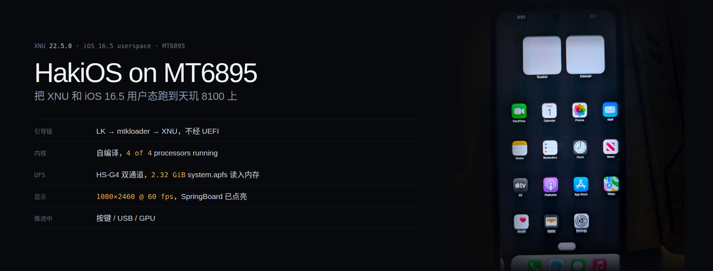
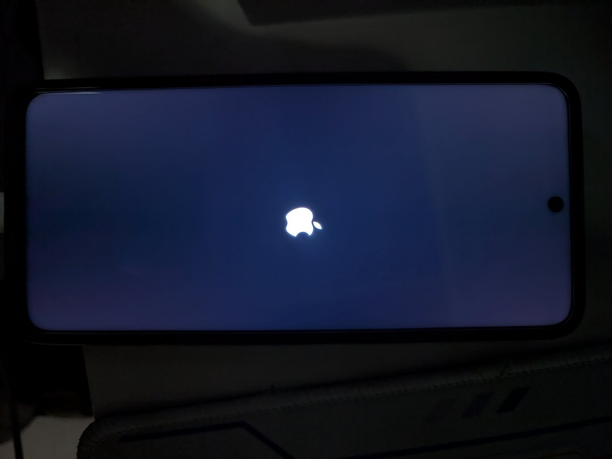

# HakiOS on MediaTek — Dimensity 8100 (MT6895)

把 Apple 开源的 XNU 内核和 iOS 16.5 用户态跑在联发科天玑 8100 上。目标机 Redmi Note 11T Pro（`xaga`，MT6895），已点亮桌面。

> 2026-11-15 源码快照：共享 PMIF 串行化、日志持久化修复和 `headset=1` 的129项纯读已通过宿主模型与内核构建，**该版本尚未刷机**。`headset=2` 的 VAUD18/时钟前置仍待补，GPU 也尚无固件发布版本或 GLOBAL_IF 的证据。验证范围与镜像哈希见 [本轮审阅记录](docs/headset-wip/validation/pmif-shared-20261115/REVIEW.md)；下文各轮实验保留为历史记录。

<p align="center">
  
</p>

<details>
<summary>开机画面（同一台机，苹果 logo）</summary>



</details>

> 实验性的 bring-up 工作，不能日用。触控已可用，电源键可用，没有 GPU 加速（3~14 fps），USB、Wi-Fi、音频还在修，重启后不保存任何设置。
>
> GPU 的 kernel 侧已经推进到「CSF 固件装好、页表建好、MCU 收到启动请求」这一步，卡在 MCU 一个指令都不执行——细节见 [Mali-G610：CSF 固件与 MCU](#mali-g610csf-固件与-mcu)。最近一轮推翻了一个用了十几轮的归因（那一位不是 bus error，是命令完成回执），并补上了厂商九步里唯一漏掉的 `MFG_I2M_PROTECTOR`。

**只想装上试试**：到 [Releases](../../releases) 下 `hakios-xaga-boot_a.img`，按 [INSTALL.md](INSTALL.md) 五步走。自己编译往下看。

---

## 目录

- [现在到哪一步了](#现在到哪一步了)
- [整体思路](#整体思路)
- [仓库结构](#仓库结构)
- [构建与刷入](#构建与刷入)
- [移植时遇到的一些困难](#移植时遇到的一些困难)
- [正在卡的地方](#正在卡的地方)
- [路线图](#路线图)
- [致谢](#致谢)
- [许可](#许可)

---

## 现在到哪一步了

| 部分 | 状态 | 说明 |
|---|---|---|
| 引导链 | ✅ | LK → `boot_a` 里的 mtkloader → XNU。不经 UEFI |
| 自编译 XNU | ✅ | `Darwin Kernel Version 22.5.0`，`4 of 4 processors are running` |
| UFS 读盘 | ✅ | HS-G4 双通道，2.32 GiB 的 `system.apfs` 读进内存 |
| 分屏与显示 | ✅ | 1080×2460 全屏可写，60 fps；画面右移已修 |
| iOS 用户态 | ✅ | SpringBoard 起来了，状态栏、小组件、Dock 全部渲染 |
| 触控（Novatek NT36672E） | ✅ | 单点/多点、长按、点击图标都对得上，落点误差 < 100 px |
| 按键（keypad + MT6363） | 🟡 | 电源键可用；音量上/下**内核与 HID 都通了**，卡在音频子系统没有输出路由 |
| USB（MTU3） | 🚧 | 控制器配置已与 Android 工作态逐位对齐，PHY 侧 D+ 仍不上拉 |
| GPU（Mali-G610） | 🟡 | 上电、时钟、识别、固件装载、AS0 页表、I2M 保护器全部在真机跑通；CSF MCU 仍未开始执行（`JOB_INT_STATUS` bit31 不升），仍走软件渲染 3~14 fps |
| Wi-Fi / 基带 / 音频 / 相机 | ⬜ | 未开始 |

画面右移已修（引擎 plane 地址对齐 kernel 写入地址），见[画面右移](#画面右移引擎的-plane-地址比-kernel-写入地址高一页)。

---

## 整体思路

```
LK (bootloader, 未改动)
  └─ boot_a:  Android Image 头 + [mtkloader] + [XNU payload]
                │
                ├─ LK 把 mtkloader 放在 0x40000000 执行（不是 Image 头写的 0x40080000）
                ├─ mtkloader 通过 UFS 把 system.apfs 读进内存，建 boot_args 与设备树
                └─ 跳进 XNU
                     ├─ XNU 以 md0 = system.apfs 为根
                     └─ /sbin/launchd → stage0 → iOS 用户态
```

**MTK 路线完全不经 UEFI**。上游 Qualcomm 机型走 UEFI → loader → XNU，MTK 的 LK 直接从 `boot_a` 起，mtkloader 是裸机程序，跑在 LK 之后、XNU 之前。

`boot_a` 的布局（由 `mtk/tools/chainboot.py` 组装）：

| 偏移 | 内容 |
|---|---|
| `0x000000` | Android Image 头（header v4，1584 字节头 + 4096 字节签名） |
| `0x040000` | 原 Android `Image`（退路用，`chain_android()` 从这里起） |
| 之后 | mtkloader 程序本身 |
| 末尾 | XNU payload（"XNUP" 魔数，装内核 + ramdisk） |

`chainboot.py` 原本 `assert hver == 2`，xaga 是 v4，已改成支持 v2/v3/v4。

---

## 仓库结构

上游 `hakios-xnu-kernel` 已经在那了，这个仓库只装我们在它之上写出来的部分。

```
tree/            直接落到上游 hakios-xnu-kernel mtk 分支上的新文件
  mtk/loader/ufs.h                            UFS 主机驱动（裸机，MMU 关闭）
  mtk/mt6895/loader/board.h                   xaga 的全部板级常量
  mtk/mt6895/drivers/input/hakios.nvt.c       Novatek NT36672E 触控
  mtk/mt6895/drivers/input/hakios.mt6895_keys.c  keypad + MT6363 按键
  mtk/mt6895/drivers/usb/hakios.mt6895_usb.c  MTU3 设备模式 gadget
  mtk/mt6895/drivers/gpu/hakios.mali610.c    Mali-G610：电源、时钟、CSF 固件、AS0 页表
  mtk/mt6895/configs/mt6895.config            SoC 层配置
  mtk/tools/xaga-{cycle,carve,auto}.sh        xaga 专用的刷机 / 刻分区 / 自动化
  mtk/tools/xaga-pull-log.sh                  从 Android 里拉内核 logbook
  mtk/tools/mknvtfw.py                        厂商触控固件转 C 头
  mtk/tools/mkfont8x16.py                     点阵字体生成（替代 swift 版）
  mtk/tools/mkmalifw.py                       厂商 CSF 固件转 C 头
  mtk/tools/nvt-slots.py                      触控报告槽位对照
patches/
  0001-upstream-changes.patch                 对上游已有文件的修改
docs/
  BOARD.md                                    板级常量的出处
  UFS.md                                      UFS 主机驱动的完整过程
  DEBUGGING.md                                没有串口时怎么取日志
screenshots/     真机照片
```

`tree/` 按原路径拷进上游工作树，`patches/0001-upstream-changes.patch` 用 `git apply` 打。当前 patch 覆盖 28 个上游已有文件；新增源码与 xaga 配置放在 `tree/`。

两个厂商固件头都不入库，用脚本从厂商 bin 生成：`drivers/input/hakios.nvt_fw.h`（847 KB，`mtk/tools/mknvtfw.py`）和`drivers/gpu/hakios.mali610_fw.h`（1.3 MB，`mtk/tools/mkmalifw.py`）。

---

## 构建与刷入

### 前置

Linux x86-64、`clang`/`lld`、`ld64`（真正的 cctools，不是 `ld64.lld`）、`gawk`、Python 3、Theos 的 iPhoneOS16.5 SDK。

### 打补丁

```bash
cd hakios-mtk                      # 上游 mtk 分支工作树
git apply /path/to/patches/0001-upstream-changes.patch
cp -a /path/to/tree/. .
make xaga_defconfig
```

### 编译

```bash
cd hakios-mtk && source xnu-env.sh

./xnu/sync-drivers.sh
# xnu/apply.sh creates a fresh tree with xnu/files; update these in an existing build tree:
cp -p xnu/files/bsd/sys/hakios.input.h xnu/files/bsd/sys/hakios.audio.h xnu/files/bsd/sys/hakios.pmif.h xnu-src/xnu-8796.121.2/bsd/sys/
cp -p xnu/files/osfmk/arm64/loader_return.c xnu-src/xnu-8796.121.2/osfmk/arm64/loader_return.c

LC_ALL=C make kernel DEVICE=xaga
make payload DEVICE=xaga

DEVICE=xaga ./mtk/loader/build.sh \
  -DBOARD_NO_UART -DBOARD_NO_OVL -DBOARD_SKIP_MENU -DBOARD_NO_CONNSYS \
  -DXNU_CORES=4 -DXNU_VERBOSE=0 -DXNU_DISPLAY=1 \
  -DXNU_WATCH_SECONDS=0 -DXNU_RETURN_AFTER='"0"' \
  -DBOARD_REPORT_PAGES=0 -DBOARD_REPORT_SYSTEM_IMAGE=0

python3 mtk/loader/build_flashed.py     # → xnu-flashed-slot_a.img（约 22.9 MB）
```

上面这组参数就是 Release 用的。调试时把 `-DXNU_RETURN_AFTER='"0"'` 换成 `'"70"'`，XNU 跑 70 秒后交回 loader，loader 自动 `chain_android()` 回 Android，再用 `sh mtk/tools/xaga-pull-log.sh $S` 取日志。

两个厂商固件头要先生成：

```bash
mtk/tools/mknvtfw.py <厂商触控 bin>        # → drivers/input/hakios.nvt_fw.h
mtk/tools/mkmalifw.py /path/to/mali_csffw.bin  # → drivers/gpu/hakios.mali610_fw.h
```

`mali_csffw.bin` 从手机的 `/vendor/firmware/` 取（`adb pull`，`su`）。它必须是**这颗 SoC 自己的那份**：不同 SoC 的 CSF 构建不可互换，RK3588 的是 274432 字节、sha256 `8e7c821a…`，当前本地内嵌的是 258048 字节、sha256 `de22d2fc…`，其提取来源尚待重新核实；xaga-r54 参考项目还提供 282624 字节的另一版本。文件大小本身不能证明某份固件正确。

GPU 的上电由 loader 做、内核只负责固件与页表，这是有意的分工：

| 宏 | 默认 | 作用 |
|---|---|---|
| `BOARD_MALI_POWER` | `1` | loader 进入 XNU 前给十二个域上电；也守卫 `chain_android()` 里的清理 |
| `BOARD_MALI_PREPOWER` | `1` | 单独关掉「预先上电」，保留清理 |
| `BOARD_MALI_DOMAINS` | `2` | `1` 只上 mfg1，`2` 上 mfg1+mfg2 |

`-DBOARD_MALI_POWER=0` 看起来像"让 loader 完全不管 GPU"，但它**同时会把清理编掉**——域留在开着的状态交给 Android 的 gpufreq，那块板会在 adb 出现之前复位，表现成一遍遍重刷同一个镜像。要做冷启动对照就用 `-DBOARD_MALI_PREPOWER=0`。

### 刷入

```bash
export S=${HAKIOS_SERIAL:?set HAKIOS_SERIAL}     # 换成自己的
adb -s $S reboot bootloader
fastboot -s $S flash boot_a xnu-flashed-slot_a.img
fastboot -s $S reboot
```

刷完停在 iOS。

### 回 Android

```bash
fastboot -s $S flash boot_a backup/boot_a_magisk.img
fastboot -s $S reboot
```

`mtk/tools/xaga-cycle.sh` 会检查备份存在才肯刷。用 KernelSU 版 `boot_a`，换官方 stock 会丢 root。

### 分区

`system.apfs`（2.32 GiB）装不进 64 MiB 的 `boot_a`，从 `userdata` 尾部刻一块 `xnusys`：

```bash
HAKIOS_SERIAL=$S mtk/tools/xaga-carve.sh --gib 2.5   # 只算不写，先看方案
HAKIOS_SERIAL=$S mtk/tools/xaga-carve.sh --gib 2.5 --write
```

`xaga` 的 GPT 用 **4096 字节逻辑块**（header 在 byte 4096，不是 512）。刻完执行 `fastboot erase userdata`，让 Android 按新尺寸重建 f2fs。

---

## 移植时遇到的一些困难

细节单独写在 `docs/` 里：

- [UFS](docs/UFS.md) —— 从读不出一个字节到 HS-G4 双通道，2.32 GiB 读进内存
- [板级常量出处](docs/BOARD.md) —— `board.h` 里每个数字从哪来
- [没有串口怎么取日志](docs/DEBUGGING.md) —— logbook、看门狗快照、像素色带

### UFS

| 症状 | 根因 |
|---|---|
| `HCS` 恒 `0x0`，写 `HCE` 读不回 1 | 电源域和参考时钟由 TFA 通过 SMC 授予，纯写寄存器无效。`MTK_SIP_UFS_CONTROL = 0xC2000276` |
| `IS` 写宽掩码后门铃彻底死 | `IS` 是写 1 清零，写 `0xffffffff` 会把整个中断状态机打死。只能写单 bit |
| 清 `HCE` 后寄存器块永久读 0 | 不能清 `HCE`。SPM 会把无时钟域断电，之后整块读 0（`IE` 仍可写 ⇒ 不是总线问题） |
| `PWR_FATAL_ERROR`、三个 READY 位全灭 | `UTRLCLR` 只能在列表停止时写（JESD223）。顺序反了控制器判死，`UTRLRSR` 再也置不上 |
| `OCS_PEER_COMM_FAILURE` | 设备 RST_n 被脉冲后对端 UniPro 栈归零，必须 `DME_RESET → DME_ENABLE → LINK_STARTUP` |
| SCSI 命令全返回 `response 0x1` | 缺 `fDeviceInit` 握手：`SET_FLAG(FDeviceInit)` 再轮询 `READ_FLAG` 清零 |
| 读盘 43 分钟 | 链路停在 PWM-G1。跑 `DME_SET(PA_PWRMODE)`，判据是 `HCS` bits 10:8 = `PWR_LOCAL`。通了之后 HS-G4 双通道，2600× |
| 8 MiB 请求超时 | 轮询预算 `UFS_MAX_POLLS` 没按数据量缩放。8 MiB 一次约需 880 万次轮询 |

`mtkloader` 全程 MMU 关闭，所有内存当 device memory：只能 32 位对齐访问、无 SIMD、非对齐宽访问会 fault 而不是读出错值。

### 引导链

LK **忽略 Image 头的 `text_offset`**，把程序固定放在 `0x40000000`。链接脚本写 `0x40080000` 的话，所有 `adrp` 绝对寻址整体偏 512 KiB，`parse_payload()` 读到的魔数是垃圾，然后静默进 `chain_android()` 循环重启。

修法：`link.ld` 改 `. = 0x40000000`，`start.S` 的 `text_offset` 改 0，栈挪到 `+0x30000`，`payload_find()` 用 `adr x0, _start` 拿真实地址。

`chain_android()` 把 `boot_a+0x40000` 的 Android Image 拷到 `0x40080000`，源在 `0x40040000`，目标比源高 —— 正向逐 8 字节拷贝会自我覆盖。改成双向拷贝加尾部逐字节。

### iOS 用户态

**Data Migration 死锁**：`36 checks 0 failed`、`Early boot complete`、SpringBoard 和 backboardd 全部 spawn，但屏幕停在 BootUI overlay 不撤，`Main will unblank` 一次都不出现。

根因是 `datamigrator` 靠 `/private/var/mobile/Library/Preferences/com.apple.migration.plist` 判断要不要迁移。文件在源码树里存在，但 `userland/build.sh` 把它写进 `var.skel` 的那段在 `if [ -d $DARWIN/rootfs/usr/lib ]` 块里，该目录不存在时整块被跳过，`/private/var` 每次启动都是空的，反复迁移。

同一个 `if` 还吞掉过 `cp obj/init root/sbin/launchd`、dyld 缓存别名、`libhakios*.dylib`。现在都挪到 `fi` 之后无条件执行。

**dyld 共享缓存**：iOS 的 `/usr/lib/libSystem.B.dylib` 只存在于 shared cache。缓存实体在 `system.apfs` 的 `/System/Cryptexes/OS/System/Library/Caches/com.apple.dyld/`，dyld 首选 `/System/Library/Caches/com.apple.dyld/`，那个目录不存在。用 APFS 合成目录的 `PATH=TARGET` 别名：

```c
check(synthetic_dir("/System/Library/Caches=/System/Cryptexes/OS/System/Library/Caches"),
      "the dyld shared cache reachable as /System/Library/Caches");
```

**launchd 权限**：`umask 0002` 会让 `root/` 树变成 0775/0664，launchd 要求 plist 只能 root 写，报 error 122。`mkapfs.py` 的 mode 取自主机文件，打镜像前先 `chmod` 一遍。

### 触控

反汇编真机的 `nvt36672c.ko`、对着 `nt36xxx*.c` 逐函数比对，才把这条链走通。踩过的坑按代价从大到小：

1. **所有多字节写的第一个字节必须置 bit7**（`SPI_WRITE_MASK`）。漏了芯片把每块当**读**，139264 字节固件一个都没进去，而 CRC 还会"通过"——读回来的是事件缓冲的填充值 `0x77`。我为此以为固件灌好了，其实一个字节都没写。
2. **`touch_eng_rst` 和 `touch_keep_fw` 不能同时开**。前者把芯片复位进 bootloader ROM，后者拒绝灌镜像，芯片整轮停在"等镜像"，读出来的 FWINFO 是垃圾（`ver c0 xnum 91`）、`reset state` 低于 `0xA0`。我曾把这个状态当成"芯片 flash 里的固件不在跑"，是很贵的误判。现在代码里直接拒绝这个组合。
3. **INT 高有效，且脉冲只有微秒级**。第一版主循环用「连读 256 次 GPIO 再睡 200 ms」，那 256 次只覆盖 25 µs，而 Android 侧 `mtk-eint 135` 大约每 6.5 ms 一个边沿 —— 等于漏掉 99% 的脉冲。改成「等待本身就是采样循环」：每 50 µs 采一次、铺满整个 200 ms 窗口，边沿计数从 0 变成几十。
4. **`bad report` 分支不能 `continue`**。它跳过循环末尾的 `delay(200000)`，把 200 ms 的读节奏变成 2.76 ms（实测 378 次读 / 1.044 s）。注释里我自己写过「读速必须比报告率低两个数量级」，结果坏路径成了最快路径，正好把芯片状态机推过头、读出 `0x77`。
5. **`taken` 要提到 `for` 之外**。原来声明在循环体内每轮重置，`taken < 16` 恒真，逐字节 dump 每轮都打，把 1 MB 内核环缓冲塞满 —— 这是「日志里看不到更早输出」的真凶。
6. `nvt_read()` 不设 page（厂商依赖 probe 时锁存），每个 CRC 读之前必须显式 `nvt_set_page()`。
7. 指纹偏移是 `FINGER_BYTES * i`，不是 `1 + 6*i`。

8. **固件要选 Android 自己加载的那一份，不是身份对得上的那一份**。这条最贵：`novatek_nt36672e_l16_fw01.bin` 的 FWINFO 是 `xnum 16 ynum 36 xmax 1080 ymax 2460`，跟 Android 报的一字不差，看着完美；灌进去基线卡 `a1` 三十秒不动，一个报告都不出。`novatek_ts_fw.bin` 的 FWINFO 是 `xnum 18 ymax 2400`，看着"错"，却能跑——我曾拿它当正确答案，就是它让 y 轴被压成 243 个码值。真相在开机 dmesg 里：

```
nvt_match_fw 1260: start match fw name
nvt_get_panel_type 1240: match panle type, fw is [novatek_nt36672e_l16_fw02.bin]
update_firmware_request 321: filename is novatek_nt36672e_l16_fw02.bin
nvt_bin_header_parser 182: ovly_info = 1, ilm_dlm_num = 2, ovly_sec_num = 2, info_sec_num = 13, partition = 17
nvt_update_firmware 1180: Update firmware success! <83891 us>
nvt_get_fw_info 754: FW type is 0x01, fw_ver=22
```

`nvt_match_fw` 按 lockdown 字节 `0x53 0x42`（CSOT 面板）选了 cfg_1 → **fw02**。也就是说 `fw_ver=22` 不是芯片出厂固件，而是刚写进去的 fw02 报的版本 —— "12 个 bin 里没有 22 号版本"曾被我当成"Android 没灌固件"的证据，其实是版本号藏在固件内部的 info 区，跟 `nvt_get_fw_need_write_size` 取的那个字节不是一回事。

9. **换对固件后，报点格式也变了：4bit 压缩 → 10× 十分之一像素**。旧固件下 `x=(b1<<4)|(b3>>4)`、`y=(b2<<4)|(b3&0xf)`，y 只有 8+4 位所以跨度只剩 243；fw02 下是 `x=(b1<<8)|b2 / 10`、`y=(b3<<8)|b4 / 10`，直接满量程。我曾用 10× 分支解出 x=1568（>1080）而否掉它 —— 那是旧固件下的数值，换了固件就对了。**x 也不需要镜像**：`1080−x` 同样是旧固件的假象。

还有两个框架级的：XNU 的 `delay(int usec)` 收**微秒**，按毫秒写会短 1000 倍；logbook 是**环形缓冲**，判读前必须先按 header 的 `len` 截断，否则会把上一次启动的残留当成这一次的证据（我因此误判过两次）。

打通后的日志：

```
nvt: the image was accepted on attempt 1; the reset state reads a0
nvt: crc flags 04 (done 1 ilm 0 dlm 0); ilm e970fade vs e970fade same; dlm c55414aa vs c55414aa same
nvt: fw info ver 22 (~dd) xnum 16 ynum 36 xmax 1080 ymax 2460 buttons 0; consistent
nvt: slots 1:2/103,2280 all 0a 04 08 59 17 07 ff ff ...
nvt: 400 reports, 42 positions, 400 edges on the line, 0 bad; line idle
```

`0a` = `(1<<3)|2`：手指 1、状态 2（按下/移动）。`04 08 59` → `x=((0x04<<8)|0x08)/10 = 103`、`y=((0x59<<8)|0x17)/10 = 2280`。

五点标定对照（fw02 + 10× 解码）：

| 按的位置 | 驱动解出 | Android 同位置 | 差 |
|---|---|---|---|
| 左下 | (103, 2280) | (91, 2363) | +12, −83 |
| 右下 | (981, 2360) | (1003, 2383) | −22, −23 |
| 左上 | (113, 100) | (91, 157) | +22, −57 |
| 右上 | (965, 134) | (997, 116) | −32, +18 |
| 中心 | (535, 1385) | (573, 1290) | −38, +95 |

最大误差 95 px，约半个指尖。实际点图标能打中。

用户态侧不用改 —— 属性协商本来就是通的：

```
[08:00:26.923] [TouchEvents] digitizer attached
[08:00:26.923] [TouchEvents] *** acquired main display digitizer (after 0.00561577s)
[08:01:09.326] [TouchEvents] create touch stream <BKDigitizerTouchStreamClient: … pid: 6(vD); SpringBoard; system-gestures
   hakios: input: sample type 1 finger 1 at 15670 19268
   hakios: input: sample type 3 finger 1 at 15670 19268
   hakios: input: sample type 1 finger 2 at 39478 6902
```

`sample type 1` = DOWN、`3` = UP。`create touch stream` 且 `pid: 6(vD); SpringBoard` 说明上层消费者已经订阅 —— 有些 MTK 移植停在「`digitizer attached` 之后没有 `create touch stream`」，那是 HID 服务属性（`bundleID`/`pid`/`PrimaryUsagePage`）没补全，让 backboardd 判成「matched 但不可用」。

---

### 画面右移：引擎的 plane 地址比 kernel 写入地址高一页

排错顺序是这样的，每一步都排掉一个嫌疑：

- `MiniIOMobileFramebuffer: swap 7 layer 0: surface 3 (1080x2460 'BGRA') from 0,0 1080x2460 to 0,0 1080x2460` —— 合成器坐标完全恒等
- `dsi size_con 0x99c0168`：`[31:16]=0x99c=2460`、`[15:0]=0x168=360`，而 `360 = 1080/3` 正是 DSC 3:1 压缩后的每行字节数，DSI 侧自洽
- `panel 1080x2460 rowbytes 4352, picture 1080x2460 crop 0 fill 1080` —— XNU 侧几何全对

dump OVL 还有一个坑：`src_con 0x2` 说明在用的是 **layer 1**，第一版只读 layer 0 的寄存器，全是 0、看着像"没配"。按 `src_con` 选层、扫全部 6 块之后才看到真相：

```
ovl4 l0 size 0x99c021c offset 0 pitch 0x1100 addr 0xfe14f000
ovl6 l0 size 0x99c021c offset 0 pitch 0x1100 addr 0xfe14f870
```

`offset` 全 0、`size` 是完整的 2460×1080，但 **addr 是 `0xfe14f000`，而 loader 交给 kernel 的是 `0xfe14e000`** —— 差一页 `0x1000`，在 pitch 4352 下正好每行错开 1024 像素，看起来就是整体右移。

两条从 kernel 侧闭合的路都试过，都不行：

1. **驱动里把 `fBase` 往前挪一页** ⇒ 帧缓冲映射是 `round_page(height * rowbytes)`，没有余量，最后几行写到映射外，`drawRows()` data abort。
2. **把 `LK_FB_BASE` 改成 `0xfe14f000`** ⇒ 写入仍在区域内，但面板打 SError（总线拒绝正在被覆盖的那帧）。

最后反过来做：**把引擎的 plane 地址下移一页，对到 kernel 写入的地方**。不碰任何内存映射，只写一次寄存器，`fb_disp` 下一次 swap 就能验证。

关键是那一次写要**给所有 plane 加同一个 delta**，而不是都设成同一个地址：

| 做法 | 现象 |
|---|---|
| 两层都设成 target | 两层扫同一块内存 ⇒ 分块 + 横向撕裂 |
| 保留相对偏移但参照点取最高层 | delta 差一个 DSC slice（540 px × 4 = `0x870`）⇒ 画面从正中裂开、左右互换 |
| 只移动最低层 | 左半对、右半错 |
| **所有 plane 加同一个 delta** | ✅ 正常 |

`ovl6 - ovl4 = 0x870 = 540 像素 × 4`，而面板的 `DSC_SLICE_WIDTH` 正好是 540 —— 这不是巧合，两层扫的是同一幅画面的两个 slice。

### Mali-G610：CSF 固件与 MCU

这颗 GPU 和 Adreno 完全不是一个结构。Valhall 之后的 Mali 把调度搬到了一颗**片上 Cortex-M7**（CSF 固件）里：AP 侧只负责上电、建页表、把固件映像装进共享内存，然后把 `MCU_CONTROL` 写 `AUTO`，之后所有 job 都靠门铃和共享接口跟它说话。所以「GPU 驱动」在这台机器上是两段完全不同的活：一段是电源与时钟，一段是跟 M7 的握手。

#### 电源：十二个域，缺一个都不行

MT6895 的 MFG 电源域是 **十二个**（`mtk-scpsys-mt6895.c`，`ctl_offs 0xEBC..0xEE8`，步长 4），依赖链是 `mfg1→mfg2→{mfg3..mfg6}`、`mfg3→mfg7→mfg9`、`mfg4→mfg8`、`mfg5→mfg10→mfg12`、`mfg6→mfg11`。`mfg1` 在厂商头文件里就标注着 `/* MPU, CM7 */`——**M7 就在第一个域里**。

踩的第一个坑是「ACK 不可靠」：`.sta_mask = GENMASK(31,30)` 这两位在真机上经常只回 `01` 而不是 `11`，但域其实已经起来了。按 ACK 做 early-return 会留下半开的域，所以改成「写完之后按 `0x1C001F34` 的实际状态统计，ACK 只当参考」。

踩的第二个坑更贵：`0x1C001F3C` 这个偏移在厂商 `gpufreq_mt6895.h` 里叫 `PWR_STATUS_OFS`，但 `clkchk-mt6895.c` 里 `0xF34` 才叫 `PWR_STATUS`、`0xF3C` 是 `XPU_PWR_STATUS`。**照抄厂商那份判定会永远读到 `0x4`。**

踩的第三个坑是 SRAM：十二个域**每个都带 `sram_pdn_bits GENMASK(8,8)` / `sram_pdn_ack_bits GENMASK(12,12)`**，包括 mfg1 和 mfg2。只做「置 `PWR_ON`+`PWR_ON_2ND`、清 `ISO`/`CLK_DIS`、置 `RST_B`」而不清 SRAM 掉电位，域会漂亮地报 `ACK=3`，然后 M7 **一条指令都取不到、也不报 fault**。控制字长这样：

```
0xc000110d   bit8=1 SRAM_PDN  bit12=1 SRAM_ACK   ← M7 的 SRAM 还在掉电
0xc000000d   bit8=0          bit12=0            ← 正常
```

这个坑的样子值得记下来：EPU 状态一切正常、`MCU_STATUS` 停在 `ENABLED`、`AS_FAULTSTATUS` 恒 0、MMU 无页错、写 `DISABLE` 也不回落。看起来像「固件有 bug」，实际是**核没电**。

#### 时钟

两路要分开看：

- `mfg_sel_0`（`CLK_CFG_30` bit16）走 `mfg_ref_ck`（26 MHz 晶振）或 `mfgpll_ck`
- `mfg_sel_1`（`CLK_CFG_30` bit17）走 `mfgsc_ref_ck` 或 `mfgscpll_ck`，而 `mfgsc_ref_sel`（`CLK_CFG_5` bit1:0）又能在 `{26 MHz, univpll_d6, mainpll_d5_d2}` 里选

先切 **26 MHz 晶振**再上 PLL，是个有用的排错顺序：晶振在全 SoC 常开，选它不可能让 GPU 完全没时钟。如果 26 MHz 下 `GPU_ID` 能答（`0xa8670004`），就说明供电一直是对的、只缺时钟；若仍为 0，问题在别处，再怎么调 PLL 也找不到。

MFGPLL 300 MHz 是厂商表里最低的一档：`26M × 0x1713b1 / 2^14 / 8`，VCO 2400 MHz 落在 1500..3800 窗口里。寄存器顺序是 `CON3` 置 `PWR_ON` → 清 `ISO_EN` → `CON1` 写 `PCW_CHG|POSDIV_8|PCW` → `CON0` 置 `PLL_EN` → 最后才 `CLK_CFG_30_SET` 切 `mfg_sel_0`。这样 PLL 失败也还留在晶振上跑。

#### 两段容易漏的厂商代码

`gpufreq/v1` 有、`v2`（mt6895）**没有**的两段，正是最容易漏的：

```c
/* MFG_ASYNC_CON 0x13FBF020：v2 只开 [23]/[25] 的 SLV 侧，master 侧没人开 */
val |= (1 << 22) | (1 << 23) | (1 << 24) | (1 << 25);
/* MFG_QCHANNEL_CON 0x13FBF0B4 [4] QCHANNEL_ENABLE */
/* MFG_ASYNC_CON_1 0x13FBF024 [0] FAXI_CK_SOC_IN_EN */
```

以及一个**观测窗口**，厂商自己在 `__gpufreq_check_bus_idle()` 里用：

```c
writel(0x1,  mfg + 0xB4);    /* MFG_ACTIVE_SEL */
writel(0x3,  mfg + 0x170);   /* MFG_DEBUG_TOP_SEL */
/* 0x13FBF178 bit2: 1 = 总线空闲, 0 = 有事务 */
```

这是判断「MFG 的 AXI 上到底有没有东西在跑」的唯一现成出口，比猜寄存器有用。

#### 页表与地址空间

CSF 的 MMU 和我们熟悉的 ARM SMMU 不是一回事，它是 Mali 自己那套：`AS0` 归 MCU，`AS1..AS7` 给 context。MCU 的地址空间号是 **0**（`mali_kbase_csf_firmware.h` 里 `#define MCU_AS_NR 0`），不是 1。

三个容易写错的地方：

| 项 | 正确值 | 说明 |
|---|---|---|
| 表指针（L0–L2）编码 | `3` | 不是 `1`；`1` 是 L0–L2 的 block 映射 |
| 叶页（L3）编码 | `3` | |
| `AS_TRANSCFG` | `0x42000006` | `ADRMODE_AARCH64_4K(6)` + `PTW_MEMATTR_WB(2<<24)` + `PTW_RA(1<<30)` |
| `AS_MEMATTR` | `0x00084c8d888d8f88` | kbase 的固定索引表，不是 panthor 那套 `mair_to_memattr` |

`AS_COMMAND` 只有 `UPDATE(1)` 会真正触发走查。**每一次 UPDATE 都会抬 `MMU_IRQ_RAWSTAT` 里对应的 `MMU_BUS_ERROR(n)`（bit `n+16`）**——七个地址空间各一位，一个不漏，详见下面「一个被用错了十几轮的前提」。CSF 构建下的 kbase 把 bus-error 的处理全包在 `#if !MALI_USE_CSF` 里，也就是说这个位在 Android 上大概率也一直挂着，只是没人读。**`AS_FAULTSTATUS`/`AS_FAULTADDRESS` 只对页错误有意义，对 bus error 没有**——它们恒 0 不能当作「没有 fault」的证据。

#### 固件容器

`/vendor/firmware/mali_csffw.bin` 是 258048 字节的自描述容器，magic `0xc3f13a6e`。头里两个字段容易混：

```
off 16 = 0x300 = 768   ← entry 表尾（不是文件长度！）
off 20 = 0x2000 = 8192
```

按 768 解析，21 条 entry 干净收尾：10 条 iface（其中 3 条是 protected-mode、2 条 size 0）+ type1×4 + type3×5 + type6×1 + type5×1。

向量表在 section 0，头两个字是 `0x02040000`（初始 MSP）和 `0x010018ed`（Reset_Handler，Thumb 位）。**VTOR 必须是 0，固件自己不设**；而 `MSP = 0x02040000` 落在 section 2 上界 `0x203e000` 之外 0x2000 字节——这条到现在还没修，等 MCU 真能跑起来再说。

#### Google 与 MTK 在这里的分叉

`/proc/gpufreqv2/gpufreq_status` 是很值得翻的东西，它一句话说清了为什么「照抄厂商 gpufreq 的上电九步」是死路：

```
[Common-Status] GPUEB Support: On
```

`gpueb-support = <1>` 意味着 `gpufreq_mt6895.c` 的 probe 直接 `goto register_fp`，**整段跳过 `__gpufreq_power_control()`**——那条九步 POWER_ON 在 xaga 上根本不执行，GPU 的电源和时钟由一颗独立的 GPUEB 协处理器自己管。所以 AP 侧看到的 SPM 十二域状态，不一定是 GPUEB 认的那份。

---

## 正在卡的地方

### USB：PHY 的 D+ 拉不起来

控制器寄存器已经和 Android 工作态逐位对齐（`MISC_CTRL 0x80000003`、`LTSSM_CTRL 0x223`、`U3_CTRL_0P 0x88`、`DEVICE_CONTROL 0x99`、`POWER_MANAGEMENT 0x64e1`），`SOFT_CONN` 也置上了，但：

- `USB20_OPSTATE` 恒 0
- 六个 cable 中断（`CONN`/`DISCONN`/`SOF`/`RESET`/`RESUME`/`SUSPEND`）全部使能，几秒内零触发
- 主机侧 `dmesg` 在整个 iOS 窗口里零 USB 事件

MAC 侧没看到主机，问题在 PHY 的 D+ 比较器。已排除：

| 尝试 | 结果 |
|---|---|
| PHY 全量 bring-up（`ACR0`/`ACR1`/`ACR5`/`ACR6`/`DTM1`，按 `phy-mtk-xsphy.c` 顺序） | 写入生效，`dtm1 0x226`，D+ 仍不拉 |
| 强制 `VBUSVALID`/`AVALID` 到 `DTM1` | 无效 |
| 关 `P2A6_RG_OTG_VBUSCMP_EN` | 无效 |
| `P2A6_RG_BC11_SW_EN` 关掉 | 无效 |
| `U2_CTRL_0P` 加 `OTG_SEL`/`FORCE_IDDIG`/`RG_IDDIG` | 推错角色，`VBUS_VALID` 掉 |
| `IP_PW_CTRL0` 软复位 + 完整冷启动序列 | 干净执行，`DC_SESSION` 丢失 |
| 端口 PDN/DIS 电源循环 | 带走 `LPM_HRWE`、`DC_SESSION`、`VBUS_VALID`（后者软件写不回来） |
| `USB2_TEST_MODE` 的 `FORCE_FS` | 无效 |
| `usb_dp_selector@10005600` 切到 USB | 写进去了（`0x800`），无效 |
| VID/PID 换成 fastboot 的 `18d1:d00d` | 主机仍不枚举（排除 VMware 仲裁器） |

下一步候选：`u2_phy_slew_rate_calibrate()`（`U2FREQ` 那组寄存器全是 0，厂商在 `power_on` 之后必调的那段从未跑过），以及 PHY 的 `ref_clk`（DTS 里 `clock-names = "ref"`，从未使能）。

主机侧是 VMware 环境的 Ubuntu，手机经 USB 透传，`lsusb -t` 走 `xhci_hcd`。

### 按键

xaga 的键分在两处，这点很难从源码看出来：

| 键 | 实际路由 | 说明 |
|---|---|---|
| 音量下 | keypad `1c00e000`（`mediatek,kp`） | `hw-init-map` 只有 key 0 = 114；只在 LK 里能读到 |
| 音量上 | **MT6363** 的 home 键 | `linux,keycodes = <115>` |
| 电源 | **MT6363** 的 power 键 | `linux,keycodes = <116>` |

keypad 的五个 16 位状态寄存器在真机上恒读 `ffff`（Android 里也一样），所以音量上/电源根本不在这块。它们挂在 `/spmi@1c804000/pmic@4/mt6363keys`，要走 SPMI。

#### 先确定寄存器，再确定传输

`/sys/kernel/debug/regmap/0-04/registers` 就是 MT6363 的完整寄存器表（65536 行，需先挂 debugfs），既能看到真实值，也能在按键时抓差分。用它确认了三件事：

- 键状态寄存器是 **`0x001e`**，不是厂商 mt6359 用的 `TOPSTATUS 0x2a`（本机 `0x2a` 恒 `0x88`，按键时不动）。
- **bit 1 = 电源、bit 3 = 音量上**，位清 0 表示按下。
- 按住音量上：`001e: 1e → 16`（异或 `0x08`）；按住电源：`001e: 1e → 1c`（异或 `0x02`）。

先把这个定下来很关键：否则传输修通之后仍然读不到东西，会误以为是传输还没通。

#### SPMI 的四道坎

**一、通道号是数组下标，不是字节偏移。** DTS 的 `swinf_ch_start = 0x0a`，厂商算法是 `PMIF_CHAN_OFFSET(5) × soc_chan(2) = 10`，加在寄存器表的**下标**上。十个下标之后是 `SWINF_2`。第一版把 `0x0a` 直接加在 `SWINF_0` 的地址上（`0x0c0a`），落在 `SWINF_0` 自己的 dword 中间，传输永远等不到完成。

**二、这块板的 PMIF 是 mt8195 那套布局，不是 mt6873 那套。** 用 `pmif_access` 逐个偏移扫出来对照：

| 寄存器 | mt8195 | mt6873 | 实测 |
|---|---|---|---|
| `CMDISSUE_EN` | `0x03B8` | `0x03B4` | `0x3B8` 读得出 `0x1`，`0x3B4` 恒 `0` |
| `TIMER_CTRL` | `0x03E4` | `0x03E0` | `0x3E4` 读得出 `0x3`，`0x3E0` 恒 `0` |
| `SPI_MODE_CTRL` | `0x0408` | `0x0400` | `0x408` 读得出 `0x225d`，`0x400` 恒 `0` |
| `SWINF_2_ACC` | `0x0880` | `0x0C80` | `0x880` 读得出 `0xc50011c4`，`0xC80` 恒 `0` |
| `SWINF_2_STA` | `0x08A8` | `0x0CA8` | `0x8A8` 读得出 `0x8441`，`0xCA8` 恒 `0` |

所以这套是 `SWINF_0: ACC 0x0800 / WDATA 0x0804 / RDATA 0x0814 / VLD_CLR 0x0824 / STA 0x0828`，每通道 `0x40`。

**三、通道数只能开一个。** DTS 里 `pmif` 的窗口只有 `0x8ff` 字节，而 `SWINF_3` 在 `0x8C0`、之后的通道更远——**都在窗口外**。板上访问未映射地址是总线 abort，而且这块板没有异常向量，核心直接停死、看门狗来不及，于是反复重入同一镜像，看起来像"启动循环"。这个坑我踩了两次。改法是只用一个通道，把搜索循环整个去掉。

**四、opcode 不是 SPMI opcode。** 命令字 `(opc << 30) | (sid << 24) | ((len-1) << 16) | addr` 里的 `opc` 是 arbiter 自己的编号，厂商映射是：SPMI `0x60..0x7f` → `PMIF_CMD_REG`（`1`）、SPMI `0x20..0x2f` / `0x38..0x3f` → `PMIF_CMD_EXT_REG_LONG`（`3`）。MT63xx 的 PMIC 是 **16 位扩展寄存器**，必须用 `3`。一直写 `1` 的话，状态机会停在 `4`（错误态）而不是 `WFVLDCLR(6)`，数据寄存器读回 `0`——于是所有位都被当成"按下"，日志里出现两个键同时按住的假象。

#### 修通之后

```
mt6895-keys: 0x1e moved 0x1e 1e -> 16
mt6895-keys: pmic bit 3 down (register 16)      ← 音量上
mt6895-keys: 0x1e moved 0x1e 16 -> 1e
mt6895-keys: pmic bit 3 up (register 1e)
mt6895-keys: 0x1e moved 0x1e 1e -> 1c
mt6895-keys: pmic bit 1 down (register 1c)      ← 电源
```

再到 backboardd：

```
[Button] VolumeIncrement page:0xC usage:0xE9 downEvent:1 down
[Button]  0xC/0xE9/10201AB000002 began: ... destinations:<system; display: builtin; pid: 5
[Button] VolumeIncrement page:0xC usage:0xE9 downEvent:0 up
[Button]  0xC/0xE9/10201AB000002 finished: firstDown:0.142s ago
```

**电源键能熄屏**，说明内核 → HID → backboardd 这条链是完整的。音量键的 HID 事件也一样成对到达 backboardd，但系统音量不变、音量条不弹——backboardd 收到后要把音量转给音频系统，而这台机器的音频只有一个空壳驱动（`HakiosAudio.driver`）和 `/dev/hakios-audio`，没有当前输出路由，没有可调的音量。**所以音量键的剩余工作量属于音频子系统，不属于按键驱动。**

### GPU：M7 收到了启动请求，但一个指令都没执行

上电、时钟、识别都通了：

```
mali: mfg1  MPU on: 0xc000000d
mali: mfg2  L2 on: 0xc000000d
mali: gpu_id 0xa8670004 l2 0x7130306 shader 0x130013
mali: pll: con0 0x15445 con1 0x31713b1 con3 0x80000001 cfg5 0x1010182 cfg30 0xff010000
mali: this is GPU 0xa8670004, CSF 0x40a0412
mali: mmu 0x2830 (va 48 bits, pa 40 bits) address spaces 0xff
mali: power settle: found 0x600 (all 1 single 1)
```

固件装载、页表走查、AS0 使能也是干净的：

```
mali: firmware 258048 bytes, header 0.1, entry table ends at 768
mali: 7 sections, 8 page tables
mali: walk 0:        L0 0x50008403 L1 0x5000c403 L2 0x50010403 L3 0x40000050004fc3 page
mali: walk 0x1000000: ... page
mali: AS0 readback: transtab 0x50000000 memattr 0x84c8d888d8f88 transcfg 0x42000006
```

然后就没有然后了。判据是一个**哨兵**：把 `0xff5aa5f0` 写进共享页的 `version` 字（CSF 固件启动后第一件事就是把版本号写在那儿），启动 MCU，等一秒，再读回来：

```
mali: sentinel 0xff5aa5f0 written to the version word
mali: MCU status 0 before the start request
mali: spin 0: status 1 job 0 mmu 0 fault 0 at 0 top 0x1b
...
mali: the start loop ended after 1000000 spins (halt seen 0, fatal seen 0)
mali: MCU status 1 (enabled and running), job irq 0
mali: version word 0xff5aa5f0 (untouched, so no instruction ran)
```

**核一个指令都没执行。** 而且：

- `AS_FAULTSTATUS`/`AS_FAULTADDRESS` 恒 0 ⇒ 不是取指 fault
- `JOB_INT_STATUS` 的 `GLOBAL_IF(bit31)` 从未升起
- 百万次自旋里 `MCU_STATUS` 从未变成 `2`（HALT）或 `3`（FATAL）——而 Android 每一轮都能读到 `2`
- 写 `MCU_CONTROL = DISABLE` 之后状态仍停在 `1`，状态机出不来
- MFG 的 AXI 从启动那一刻起就 `0x1b`（非空闲），一直不回落，且**关掉核也不回落**

为了排除「是不是固件有问题」，做过一个决定性实验：**把固件入口换成自己写的 32 字节 Thumb 桩**（按 Cortex-M 的假设写的；G610 的 CSF 核到底是哪一颗 ARM 核，公开资料里查不到，这也是这个实验的一个弱点）——三条 `str` 到共享页，分别是 `0x11`、`0x22`、`0xdeadbeef`，不需要栈、不碰共享接口、不碰 `0x40000000` 那组内部寄存器：

```asm
movw r0, #0x0000 ; movt r0, #0x0400   ; r0 = 0x04000000
movw r1, #0x0011 ; str  r1, [r0]
movw r1, #0x0022 ; str  r1, [r0, #4]
movw r1, #0xbeef ; movt r1, #0xdead
str  r1, [r0]     ; b .
```

结果一样：`version word 0xff5aa5f0 untouched`。**换成自己写的桩都不跑，所以问题不在固件。**

已排除的（每条都有真机读数或源码对照，不是推测）：

| 假设 | 排除依据 |
|---|---|
| 固件与 Android 不同 | `sha256` 逐字节相同（`de22d2fc…`） |
| 固件段载入有缺口 | 10 段全部映射成功（含三节 `.bss`），叶描述符低两位 `11` |
| 页表编码错 | 表指针 `3` / 叶页 `3` / block `1`，与 kbase 一致 |
| `ASN_HASH` 未配 | G610（arch 10）根本没有这组寄存器，回读全 0 |
| 硬件 issue 寄存器非零 | 上电默认就是 `shader 0 tiler 0 l2mmu 0 csf 0` |
| MFG1 的 AXI 总线保护 | 四条全部释放，释放前后结果相同 |
| `PWR_ACTIVE` 未升起 | panthor 有这个位但全树零使用，kbase 无定义 |
| MFG0 域没开 | mt6895 域表里没有 MFG0（只有 mfg1..mfg12） |
| `0x40000000` 未映射 | 那是 GPU 内部固定译码窗口，本来就不该映射 |
| 页表落在 8.5 GiB 超范围 | 搬到 1.25 GiB 后结果不变 |
| AS 配置写不进 | 三份配置回读逐字正确 |
| 电源没 settle | `POWER_CHANGED_ALL` 已在，`found 0x600` |
| `mfg_sel_1` 时钟 | `cfg5 0x1010182` = `mainpll_d5_d2`，与 Android 一致 |
| VSTACK 没开 | 已打开（`status 0x6e enabled 1`） |
| master 侧 AXI 门没开 | 六项寄存器读时就已经是目标值 |
| 冷路径 vs 热路径 | 两条路径结果完全一样 |
| AS0 使能在 L2 上电之前/之后 | 顺序换过，`0x10000` 照旧 |
| 页表内容 | `transtab=0`、`transcfg=0x42000001`（UNMAPPED）也报同样的错 |
| 固件 `.bss` 未映射 | 三节 `flags & PROTECTED` 改成普通页映射后（10 段 / 9 张表）结果不变 |
| `MFG_I2M_PROTECTOR` 未编程 | 补上 vendor 四条 + arm 位，回读 `0x20300317 0x1800000c 0x1010802 0x227f3`，结果不变 |
| `g3d_mpu` 未初始化 | 读通，64 字里五个非零且不随状态变化，从未被软件编程 |
| 时钟/计数器死了 | `cycle` 与 `timestamp` 在长轮询期间都在涨（约 340M tick/s） |

### 一个被用错了十几轮的前提：那一位根本不是 bus error

很长一段时间里，所有分析都建立在两句话上：*AS0 的 `AS_COMMAND=UPDATE` 会报 `MMU_BUS_ERROR(0)`*，而且*这个错误是 AS0 特有的，因为 AS2 到 AS7 用一模一样的写法从不报错*。

第一句来自 `mali_kbase_gpu_regmap.h:248`：`#define MMU_BUS_ERROR(n) (1UL << ((n) + MMU_PAGE_FAULT_FLAGS))`，`MMU_PAGE_FAULT_FLAGS = 16`。按这个定义，bit16 就是 `MMU_BUS_ERROR(0)`，看起来完全对得上。

**两句话都是错的。**

先说第二句：它从来没有被测量过。`as_park_unused()` 的循环写完就进下一轮，既不清中断锁存也不读回，只有 AS0 的锁存被真正读过。补上测量之后（每个空间 `clear → write → read`），七个空间各占一位、一一对应：

```
mali: AS2 parked, mmu irq 0x40000      bit18
mali: AS3 parked, mmu irq 0x80000      bit19
mali: AS4 parked, mmu irq 0x100000     bit20
mali: AS5 parked, mmu irq 0x200000     bit21
mali: AS6 parked, mmu irq 0x400000     bit22
mali: AS7 parked, mmu irq 0x800000     bit23
mali: AS0 step update    mmu irq 0x10000    bit16
```

第一句错得更彻底。同一批位在 arch 10 上有另一套含义，panthor 写得很直白：

```c
/* drivers/gpu/drm/panthor/panthor_mmu.c:655 */
static u32 panthor_mmu_fault_mask(struct panthor_device *ptdev, u32 value)
{
	/* Bits 16 to 31 mean REQ_COMPLETE. */
	return value & GENMASK(15, 0);
}
```

**bit16..31 是 `REQ_COMPLETE`——每个地址空间的命令完成回执，不是错误。** panthor 全树 `grep BUS_ERROR` 是 0 命中；kbase 那份定义则整体包在 `#if !MALI_USE_CSF` 里（`mali_kbase_mmu_hw_direct.c:229`、`:261`），CSF 构建下从来不用它，也从来不清它——所以它只增不减、看着像"永不回落"，只是因为没人清。

于是七次 UPDATE 全部**成功**了，七位是七张回执。连 `transtab=0`、`transcfg=0x42000001`（UNMAPPED，物理上根本不走表）也报一位，正是回执该有的样子。`AS_FAULTSTATUS` 恒 0 也不是"bus error 不留痕"，而是**真的没有 fault**。

这条错误归因把工作带偏了很久：它让「GPU 的 AXI 读不到 DRAM」变成一个看似已被证实的结论，于是所有精力都花在总线上。真实情况简单得多——**固件一条指令都没跑**。哨兵 `0xff5aa5f0` 原样读回就是最直接的证据：什么都没写过。

### 现在的判断：`MCU_CONTROL=AUTO` 之后，核一次都没取指

真正的判据只有一个，panthor 的实现写得最清楚（`panthor_fw.c:1104-1125`）：

```c
if (!ptdev->fw->booted && (status & JOB_INT_GLOBAL_IF))
	ptdev->fw->booted = true;
```

**`JOB_INT_STATUS` 的 bit31。** 不是 `MCU_STATUS`。Android 冷启动的 2460 条寄存器轨迹里，`MCU_CONTROL=2` 之后 27 条记录内 bit31 就升起来了；这台机器上自旋一百万次也见不到。

失败时的全套读数（每轮都一样）：

```
mali: MCU status 0 before the start request
mali: spin 0: status 1 job 0 mmu 0 fault 0 at 0 top 0x1b
mali: the start loop ended after 1000000 spins (halt seen 0, fatal seen 0)
mali: MCU status 1 (enabled and running), job irq 0, gpu irq 0
mali: clock check: cycle 0x99f31ca0 -> 0x99f850de, timestamp 0x207a50df -> 0x207a8a98
mali: version word 0xff5aa5f0 (untouched, so no instruction ran)
mali: bus idle after the failed start: ... debug_top 0x1b (still busy after 100000 spins)
mali: MCU control written 0, status now 1, control reads 0
```

三条值得注意的：

- **时钟是活的。** `cycle` 和 `timestamp` 两个计数器在长轮询期间都在涨（约 340M tick/s），所以"没时钟"解释不了一切。
- **`MCU_STATUS` 对控制寄存器完全不响应。** 写 `MCU_CONTROL=0`（DISABLE）之后状态仍读 1，控制字回读 0。这不是"核起来后停等"，是更早的一层。
- **`debug_top` 从 0x4（idle）变成 0x1b 并永不回落。** MT6895 的 v2 语义是 `bit0 = 1 → bus busy`（旧平台 v1 用 bit2 且相反，抄错平台会得出反向结论）。

### 一条刚补上的、vendor 从不省略的步骤：`MFG_I2M_PROTECTOR`

厂商九步上电的第九步是 `__gpufreq_gpm_control()`，而它是**无条件**执行的：

```c
/* gpufreq_mt6895.c:5195 */
/* default enable GPM 1.0, before power control */
g_gpm_enable = true;
...
/* gpufreq_mt6895.c:3347-3367 */
writel(0x20300316, g_mfg_top_base + 0xF60);   /* MFG_I2M_PROTECTOR_CFG_00 */
writel(0x1800000C, g_mfg_top_base + 0xF64);
writel(0x01010802, g_mfg_top_base + 0xF68);
writel(0x000227F3, g_mfg_top_base + 0xFA8);
udelay(1);
writel(0x20300317, g_mfg_top_base + 0xF60);   /* bit0 置上 = arm */
```

这是 vendor 九步里本驱动唯一完全没有落地的一步：一个 `initiator-to-memory` 保护器，名字取自动机 di/dt 整形，但从未编程的门就是一个答案未定义的门。同一段里还有一处顺序错：vendor 是 `acp`(:806) → `hwdcm`(:810) → `gpm`(:815)，本驱动原来是 `dcm` → `acp`，且从来没有 `gpm`——那个顺序是累积出来的，不是论证出来的。

补上之后，四条全部可写可读：

```
mali: i2m protector before the firmware: 0x20300317 0x1800000c 0x1010802 0x227f3
```

**这证明 `0x13FBFF60` 那一页在裸机上是完全可写、且 arm 位确实置上的**——但 MCU 依然一条指令都没跑。所以这个保护器不是卡点，它可以被划掉了。

### 顺手确认的两件小事

- **固件里三节 `flags & PROTECTED` 的 `.bss`（VA `0x3000000`–`0x3040000`，256 KB）此前被直接跳过、在 AS0 里完全没有映射。** kbase 的做法不是跳过而是走 protected memory allocator 分配并建映射（`mali_kbase_csf_firmware.c:521-537`），所以在裸机上改成用普通页映射。验证到了：`10 sections, 9 page tables`（原为 7 / 8），三节各自打印 `is protected-mode, mapped with ordinary memory`。**这也不是卡点。**
- **`g3d_mpu@13bff000` 可读**，64 个字里只有五个非零：`0x1c:0x11f00`、`0x48:0x1000`、`0x4c:0xff020f00`、`0x60:0x21800000`、`0xc0:0x30`，且不随 GPU 状态变化——没有被任何软件编程过。**`g3d_brisket@13bfee00` 一读就挂死总线**（整轮日志停在那里），这是第三个"未译码窗口读取永不返回"的实例，前两个是 GPUEB `0x13c40000` 和 `0x13F91034`。

### 试过并划掉的：`GLB_REQ.HALT`

共享接口页里的 `GLB_REQ` 有一位 `HALT`（`mali_gpu_csf_registers.h:1105-1106`，`GLB_REQ_HALT_MASK = 1<<0`）。2025 版 kbase 在启动 MCU 之前会先清它，注释写得很硬：

> Clear the HALT bit before triggering the boot of MCU firmware, regardless of FW I/O status.

而 r32p1（这台机器对应的版本）没有这一步——`GLB_REQ_HALT_MASK` 全树只在停机方向出现一次（`mali_kbase_csf_firmware.c:2084`），`kbase_csf_firmware_enable_mcu()` 只有一行写 `MCU_CONTROL=AUTO`（`mali_kbase_csf_firmware.h:479`）。

于是在裸机里、写 `MCU_CONTROL=AUTO` 之前，直接打开共享接口页清这一位：

```
mali: glb req 0 -> 0 (halt was already clear)
```

**它本来就是 0。** 固件映像里 `GLB_REQ` 这个字初值就是 0，从来没人置过它——这条假设当场被否掉，其余读数与上一轮逐字相同（`MCU status 0` → `spin 0: status 1 job 0 mmu 0 fault 0 at 0 top 0x1b` → `version word 0xff5aa5f0 (untouched, so no instruction ran)`）。

### 现在的唯一假设：GPU 的 AXI 事务在 SoC 侧被挡住

到这一步，MCU 启动**之前**的寄存器状态已经和 Android 冷启动轨迹逐条对齐了：

| 项 | Android 冷启动 | 本机 |
|---|---|---|
| `GPU_IRQ_MASK` (0x028) | `0x00080503` | `0x00080503` |
| `JOB_IRQ_MASK` (0x1008) | `0xffffffff`（**未解开**，但 `0x100c` 仍能读到 bit31） | `0xffffffff` |
| `MMU_IRQ_MASK` (0x2008) | `0x0000ffff` | `0x0000ffff` |
| `L2_READY` (0x160) | 1 | 1 |
| `SHADER_READY` (0x140) | 0 | 0 |
| `GPU_ID` (0x000) | `0xa8670004` | `0xa8670004` |
| IPA 序列 | `0x40010=20181004` → `0x40014..2c=0` → `0x40000=1` → `=3` → `0x40008=0` | 逐条相同 |
| AS0 编程 | `TRANSCFG=0x42000006`, `TRANSTAB=0x44b49000`, UPDATE 前后 `AS_STATUS=0` | 相同（`0x42000006` / `0x50000000`） |
| `MD_MFGSYS_PROTECT_EN_STA_0`(0x10001CAC) bit0..3 | 未采 | **`0xffffffef` → 四位全 1（保护仍在？）** |
| 写 `MCU_CONTROL` 前的其它写 | 无（不写 `0x030`/`0x050`/`0x048`/`0x304`） | 冷路径也不写 |
| 写 `MCU_CONTROL=2` 之后 | **12～27 条记录内 `0x100c` 读到 `0x80000000`** | 百万次自旋 0 |

（`Android` 那 2879 条 reset 轨迹里，`0x700=2` 出现在记录 648，`0x100c=0x80000000` 出现在 660；2460 条冷启动轨迹里分别是 136 和 163。）

所以差异不在 GPU 内部，而在**GPU 发出的 AXI 读请求有没有被 SoC 侧放行**。剩下的候选都在 SoC 侧，按"拒绝时不会产生 AXI error、只会挂住"这个特征排序：

1. **EMI MPU**（`emimpu@10226000`）。`emi_mpu_v2` 在 Android 上是活的（`dmesg` 里三条加载记录），但没有任何 debugfs/proc 出口，`/tmp/xagaoss` 与 `/tmp/mtkpd` 都不含它的源码。GPU 固件页现在放在 `0x50000000`——这是 loader 保留区之外的一个空洞，**未必落在任何 EMI MPU region 里**。
2. **`me_GPUmputab_PMA` 保护区**（`0x78800000` 页表块 4 MiB + `0x78c00000` 保护区 16 MiB，`GPR[6]` 存 PFN）。这三个地址（`0x13bff000`/`0x13bfee00`/`0x78c00000`）在 GPUEB 固件、LK、所有 `.ko` 里都是 0 命中，谁都没编程过——但"没编程"也可能意味着"用默认"，而默认未必是放行。
3. `g3d_mpu@13bff000` 的 `0x4c=0xff020f00` / `0x60=0x21800000` 这两个字看起来像地址窗口/权限位，但布局公开渠道 0 命中。

两条可执行的验证路线，都不改 GPU 侧：

- **A（只读，最快）**：裸机读 EMI MPU region 表。基址 `0x10226000`（Android `/proc/iomem` 的 `emimpu@10226000`），看 `0x50000000` 落在哪个 region、权限向量里 GPU 那一位是什么。风险：和 `0x13bfee00` 一样，未译码窗口可能挂死总线，所以要放在失败路径尾部只读一次。
- **B（改配置）**：把 MCU 页表与固件页整体从 `0x50000000` 挪进 `me_GPUmputab_PMA` 那 20 MiB（`0x78800000` 起）。如果 GMPU/EMI MPU 只放行这一块，那么搬过去就能起来。

先做 A：一次读就能定方向，而且不改任何布局。


### 本轮三个新读数（都来自真机，且都在同一份日志里）

**一、`bus protect` 的四个状态位，第一次真正读到了。** 之前的 `bus_protect_release()` 在 bring-up 最顶端，ring buffer 只留尾部，那几行每次都被冲掉；把读取挪到 `MCU_CONTROL` 写入之前再读一次，拿到了：

```
mali: bus protect sta before the start request: md0 en 0 sta 0xffffffef,
      emisys0 en 0 sta 0xff000020, emisys1 en 0 sta 0xff002020
```

把掩码对上去看：

| 组 | en | sta | 掩码 | 掩码内的 sta 位 |
|---|---|---|---|---|
| md0 (`0x0CA0`/`0x0CAC`) | `0` | `0xffffffef` | `0xf` (bit0..3) | **全是 1** |
| emisys0 (`0x0C60`/`0x0C6C`) | `0` | `0xff000020` | `0xc0000` (bit18,19) | 0 |
| emisys1 (`0x0C70`/`0x0C7C`) | `0` | `0xff002020` | `0xc0000` (bit18,19) | 0 |

按 MTK 的语义，`sta` 位为 1 表示该端口**正处于保护中**。所以 `emisys0`/`emisys1` 是真的撤掉了（bit18/19 读 0），而 **`md0` 的四个位在 `CLR` 写完之后几十毫秒仍然读回全 1**。

这条不能简单归给 `BUS_PROT_IGN`。mt6895 的四个元组确实全是 `ignore_clr_ack = true`（`scpsys.h` 的 `BUS_PROT_IGN`），`clear_bus_protection()` 写完 `CLR` 就直接 `return 0`，从不等 ack —— 但"没等"和"没生效"是两件事，而现在手里这个读数是唯一能区分它们的东西，且它指向后者。

**这个读数是误读，已经划掉。** `clkchk-mt6895.c:178` 把这个偏移的名字写得很清楚：

```c
REGNAME(infracfg, 0x0CAC, MD_MFGSYS_PROTECT_RDY_STA_0),
```

它是 **RDY_STA**（ready status），不是 `EN_STA`。而且 `gpufreq_mt6895.c:1350-1351` 是把它和 `EN_STA_0` 分开列的（`0x0CA0` 是 EN，`0x0CAC` 是 RDY）。所以：

- 原厂 Android：`ca0 = 0`（保护没开）、`cac = 0xffffffe0`（低 4 位 = 0）
- 本机：`ca0 = 0`（保护也没开）、`cac = 0xffffffef`（低 4 位 = 1）

两侧的 `EN` 都是 0 —— **保护在两边都没有开启**。`cac` 低 4 位的差异只是"mfg1 那颗域有没有上电、通路 ready 没 ready"的反映：本机把它开起来了，所以 ready 位置位。**这是结果，不是原因。**

顺带把 `bus_protect_release()` 挪到了 `power_on()` 之后（vendor 的 `scpsys_power_on()` 也是最后一步才 `bus_protect_disable()`），刷入后结果完全一致 —— 这条线彻底关掉。

**二、`mfg5..mfg12` 确实没有上电，而且现在会明说。** `domain_on()` 的判定改成三值（`(sta & GENMASK(31,30)) == GENMASK(31,30)` 且 `SRAM_PDN`/`SRAM_ACK` 都清零）之后：

```
mfg1..mfg4  on: 0xc000000d          （bit31:30 = 11 = ack ✅）
mfg5        did NOT come up: 0xd    （sta 0）❌
mfg6        did NOT come up: 0x4000000d （sta 1）❌
mfg7..mfg12 did NOT come up: 0xd    ❌
mali: 7 of twelve domains answered
mali: pwr status 0x1fc / 0x1fc (F34/F38), gpufreq 0x4 (F3C); want 0x3ffc
```

**三、Android 在 genpd 全 off 时照样能启动 MCU —— 所以这 12 个域不是 GPU 的真实供电开关。**
同一份原厂机器上连采 12 次 `pm_genpd_summary`，覆盖 `echo 1 > mali0/reset` 全程，`mfg1..mfg12` 全部停在 `off-0`，一个都没变；而同一段 reset 的寄存器轨迹里 `MCU_CONTROL=2` 之后 12 条记录内就升起了 `JOB_INT_STATUS bit31`。

→ 结论：**在 EB 模式（`gpueb-support = <1>`）下，这 12 个 genpd 只是给软件看的 view，真实供电由 GPUEB 固件接管。** 我们驱动 `power_on()` 手工去写这 12 个域的控制字，既不是 Android 做的事，也不是必需的 —— 但它也**不是**卡点（mfg1..mfg4 的 ack 是拿到的，GPU 寄存器块整块可读、`gpu_id 0xa8670004` 十七个识别字全对、`cycle counter` 一直在跑）。

### 本轮第三个坑：`mali_cold=0` 也不回 Android

补上 `bus_protect_release()` 之后 MCU 仍不启动（`spin 0..500000` 全是 `status 1 job 0`，`version word 0xff5aa5f0`），于是想换个角度：既然本机 `GPU_STATUS` 恒 `0x1`（`GPU_STATUS_ACTIVE`）而 Android 四条轨迹里全是 `0`，那可能是冷路径**没写 `GPU_COMMAND=0x101`（SOFT_RESET）**造成的。`mali_cold=0` 走的正是 reset 路径，会执行 `gpu_soft_reset()` + `gpu_hw_issues()` + `PWR_KEY` + `COHERENCY=0x1f`。

结果：**刷入后设备停在 fastboot（`idProduct=d00d`），不回 Android。** 也就是说 `mali_cold=0` 这条路本身是死的 —— 它写的那一整套（`0x030`/`0x050`/`0x304`/`0xf00-f0c`）正是 2460 条冷启动轨迹里**一条都不出现**的东西。这反过来强化了"冷路径不写这些是对的"这个判断，但也说明 `GPU_STATUS=0x1` 这个差异**不能靠切成 reset 路径来消除**。

（顺带确认：`mali_cold` 这个 boot-arg 在 `mtkloader.bin` 里能查到 3 处命中，`-DXNU_EXTRA_ARGS` 的透传是有效的 —— 不是参数没送到。）

### 本轮踩掉的两个坑（都花了刷机周期）

1. **`mali_low=0` 会让设备死在 preloader 循环里。** 把 GPU 的所有内存从 `0x50000000` 的低窗口改成 `mem_alloc_high()`（内核普通 DRAM），构建成功、boot-arg 用 `strings` 核验确实进了 commandLine（`rd=md0 -v cpus=1 mali_low=0 loader_return_after=150`），刷入后两次都是同一个结果：`idProduct=2000`（MT65xx Preloader）每 2~3 秒枚举又断开，adb/fastboot 都不出现。**原因未明，先记下来：这条路上有东西在 XNU 还没跑到 GPU 之前就挂了。**

2. **把 `mali_vstack_rail()` / `clock_26m()` 提到 `power_on()` 之前，设备根本不回 Android。** `clock_26m()` 写的是 `mfgcfg`（`0x13FBF000`），物理上在 mfg1 域内；mfg1 没上电就写它 → 总线故障、无异常向量、核心停在原地 → 看门狗复位循环。`scpsys_power_on()` 里"先 clk 后 PWR_ON"的那一步，对 MFG 是空操作（十二个域的 `basic_clk_name` 全为空），不能拿来当顺序依据。

### Codex round-1：冷启动写操作对账，先纠正证据错位

完整分析与逐条差分见 [GPU round-1](docs/GPU-ROUND-1.md)。缺失的 2460 条冷轨迹从手机已有
`/data/local/tmp/hist_before.txt` 恢复，rec136 的 AUTO 与 rec163 的 GLOBAL_IF 均对上。前文
“启动前已经逐条对齐、只可能是 SoC 侧”的结论需要收回：rec0..135 有 67 次写，所给 logbook
对应源码路径重建出 94 次写，其中 61 次同值、6 次值不同、27 次附加写。

四个真实漏对齐的字是 AS2/AS3 MEMATTR：`0x2488/0x24c8=0x888d8f88`、
`0x248c/0x24cc=0x00084c8d`，本机全写 0。另两个差异是 AS0 根表 PA 的高低字，属于各自
实际内存分配，不能直接抄 Android 地址。轨迹跳过 AS1；rec9 是 AS2，不是 AS1。AS4..AS7
MEMATTR 原本就是 0。四字出现于冷路径，但 parked AS 是 UNMAPPED，因此因果必要性仍待独立对照。

所给 logbook 的原始 boot-args 明确含 `mali_cold=0`，其 reset、PWR_KEY、ASN、cache flush
打印也互相印证。不能拿这份日志作为纯冷路径失败证据。冷轨迹从未读取 GPU_STATUS，三份
reset 轨迹的 0 都在启动前；本机 reset 后也读 0。启动失败后的 ACTIVE=1 不能直接当作启动前置障碍。

`0x3090/0x3098` 的偏移与 GPU cycle/timestamp 相同，两次 dump 的增量分别对应约 300 MHz、
13 MHz；`0x3020=0x600` 又与电源变化 IRQ 位吻合。现阶段更像 MCU 侧的硬件寄存器视图，
还需与 AP 侧计数器包围读取对照，不能据其跳动推断 MCU 已运行。后续先固定显式 cold=1 的
真机基线，再单独验证 free-run 与 AS2/AS3 属性；不重试已知不能回 Android 的 cold=0/low=0。

### Codex round-2：五次真机对照均回 Android，MCU 仍未启动

完整日志、镜像 MD5 与差分见 [GPU round-2](docs/GPU-ROUND-2.md)。五次分别是 mali=3 基线、
完整 cold=1、仅 free-run、仅 AS2/AS3 MEMATTR、两项组合，全部确认回到 Android。
完整启动四轮均无 GLOBAL_IF、哨兵未改、debug_top 保持 0x1b。free-run 目标
`GLOBAL_CON=0x030e7701` 已回读；属性实验的实录恰好只改四字，两项单开/组合均不足以修复。

新冷路径实录 82 次启动前 GPU 写，与 round-1 的 94 次模型逐项相比恰好少 12 次 reset 分支操作。
当前比 Android 多 13 次诊断 MMU clear、2 次 power IRQ clear，AS0 仍在 IRQ/IPA 后，不能称作
整条 prologue 相同。下一步应分别验证 AS0 放置顺序和两组附加 clear。

GPU_STATUS 已直接采到 AUTO 前 0、失败后 1，因此本轮没有“启动前 ACTIVE=1”这一障碍。
MCU 尚未启动时 0x3090/0x3098 就与 AP cycle/timestamp 同步，不能将其跳动当固件运行证据。
AP raw 已清 0 而 0x3020 保持 0x600，支持独立目的端锁存解释。

五轮全部带 AUTO 前 trace 打印，部分轮次增加 0.1～0.37 秒启动间隔。当前提交已将 trace 移到
启动尝试后打印，trace=0 还关闭新增包围采样；这个低干扰版本仅完成本地构建，**用户结束本轮，
尚未刷入**。不能把它写成已验证通过，也不能把带诊断开销的结论扩大为所有启动时序均已排除。

### GPU round-4：AS0-first 已实测，仍无 GLOBAL_IF

trial246低干扰trace=0已于round-3刷入并返回Android，仍未启动MCU。随后本轮加入默认0的
`mali_as0first`，只移动完整AS0块；trial400开启该开关及trace=1，返回Android且boot_completed=1。
实录82 stores，相对236精确只有13条AS0块位置变化，offset/value多重集不变。GPU_STATUS为
AUTO前0、后1；四个spin节点均top=0x1b，哨兵0xff5aa5f0未改，仍无GLOBAL_IF。
用户额度限制取消本轮as0first=0重刷。206仅作历史参考，内核及free-run/MEMATTR配置不同；
不称同内核单变量对照。详见 [round-4报告及完整文本证据](docs/GPU-ROUND-4.md)。本轮结束，等待指令。

### 卡顿：软件渲染压在 4 个 999 MHz 核上

```
hakios: no accelerated renderer; the software one will draw
CoreAnimation: Software renderer! Simulating crash!
CoreAnimation: Failed to initialize Metal or OpenGLES contexts!
[ 83.7] 46 frames in 5016 ms (9 a second), 1485 us each in the driver, after 0 us waiting for the GPU
[130.7] 20 frames in 5083 ms (3 a second)
```

驱动本身只花 **1.5 ms/帧**、`0 us waiting for the GPU`，所以瓶颈不在 framebuffer 路径，在 CPU 光栅化。而 CPU 报的是 **999 MHz**、还被 `cpus=4` 限成 4 个核。

两条低成本的改善：`cpus=4` → `cpus=8`；`XNU_BIG_CLOCK` 打开（`ARMPLL_CON1` 现在是 LK 留下的 1176 MHz 档，但内核报 999 MHz，这个不一致本身要查）。中长期是 Mesa 软件 GL（`tools/mk-mesa.sh`）——现在 `inject.c` 的 `opengl_es()` 因 `access(HAKIOS_GL, R_OK) != 0` 直接返回，连软件 GL 都没有。

---

## 路线图

- [ ] USB 枚举通过（D+ 上拉）
- [ ] USB CDC-ECM 网络链路，接上 `sys/hakios.net.h`
- [x] 触控（Novatek NT36672E）：固件选型 + 10× 解码
- [x] 按键：MT6363 `0x001e` + SPMI mt8195 布局 + `EXT_REG_LONG` opcode（电源键可用，音量键待音频）
- [x] 画面右移（引擎 plane 地址与 kernel 写入地址差一页）
- [ ] 卡顿：`cpus=8`、`XNU_BIG_CLOCK`、Mesa 软件 GL
- [x] Mali-G610：十二个电源域（含 mfg1/mfg2 的 SRAM）
- [x] Mali-G610：26 MHz 晶振 → MFGPLL 300 MHz，两路 mux 都切对
- [x] Mali-G610：CSF 固件装载（258048 B，10 段含三节 `.bss`）+ AS0 页表 + `MCU_CONTROL=AUTO`
- [x] Mali-G610：厂商九步里漏掉的 `MFG_I2M_PROTECTOR` 四条 + arm 位（`0x13FBFF60` 回读 `0x20300317`），并把 `acp → hwdcm → gpm` 的顺序改对
- [x] Mali-G610：推翻「`MMU_BUS_ERROR`」归因——bit16..31 是 `REQ_COMPLETE`，七次 UPDATE 全部成功
- [x] 试清清 `GLB_REQ.HALT`（真机回读 `glb req 0 -> 0`，本来就是 0 —— 否掉）
- [ ] Mali-G610：**`MCU_CONTROL=AUTO` 之后 `JOB_INT_STATUS` bit31 从不升起**——五次真机对照见 round-2；低干扰246及AS0-first 400均已返回Android但仍失败；round-4记录历史对照边界，当前停下待命
- [ ] Mali-G610：M2 及以后（命令流、CSG/CS 调度、IOKit 服务）
- [ ] Wi-Fi（CONNSYS）
- [ ] 音频、相机

---

## 致谢

- [oosexgang/hakios-xnu-kernel](https://github.com/oosexgang/hakios-xnu-kernel)
- [Apple xnu](https://github.com/apple-oss-distributions/xnu)
- [ios-sweet](https://github.com/dipa-studio/ios-sweet)


---

## 许可

`tree/` 与 `docs/` 下的内容按 MIT 发布，见 [LICENSE](LICENSE)。

内核侧（`drivers/`、`xnu/files/`）是 Apple XNU 的衍生作品，跟随上游按 APSL 2.0 发布。

不包含任何 Apple 的系统镜像、固件或商标，也不包含手机的厂商固件。iOS 用户态需要使用者从自己的固件里准备。
